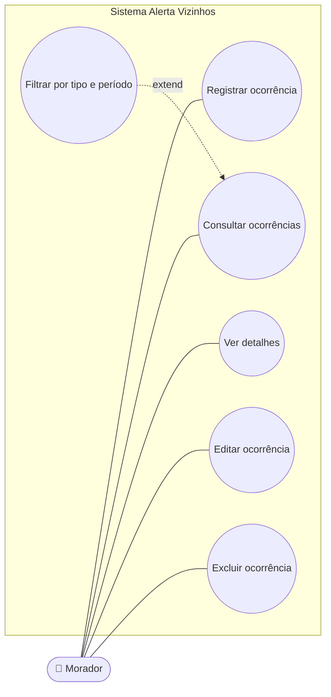
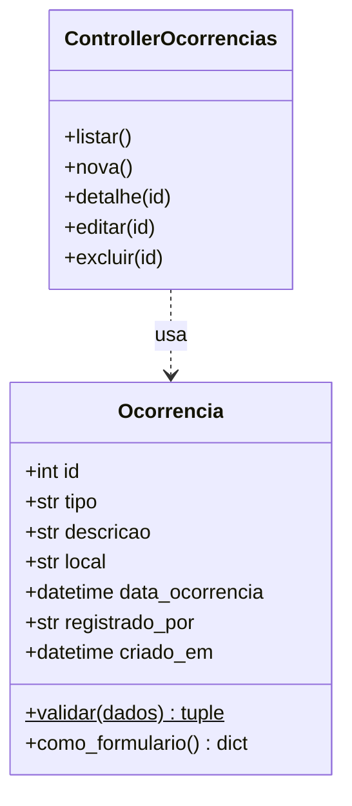
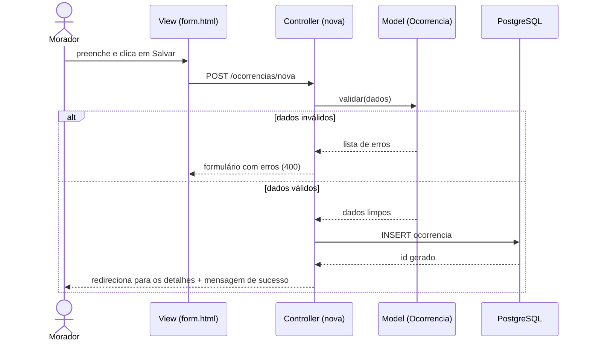
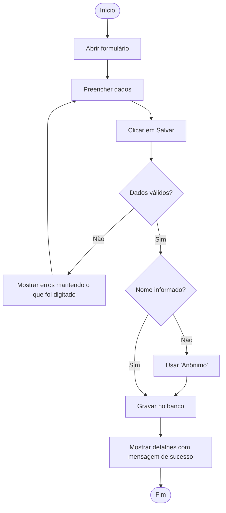

# 3. Modelagem UML

Os diagramas estão em Mermaid, que o GitHub desenha automaticamente ao abrir este arquivo.

## Diagrama de casos de uso

## Caso de uso expandido: Registrar ocorrência

| Item | Descrição |
|---|---|
| Ator | Morador |
| Pré-condição | Nenhuma (o sistema não exige login nesta versão) |
| Fluxo principal | 1. O morador clica em "+ Registrar". 2. O sistema mostra o formulário. 3. O morador preenche tipo, data e hora, local, descrição e, se quiser, o nome. 4. O morador clica em "Salvar". 5. O sistema valida os dados e grava a ocorrência. 6. O sistema mostra os detalhes com a mensagem "Ocorrência registrada com sucesso." |
| Fluxo alternativo A | No passo 5, se algum dado for inválido, o sistema mostra a lista de erros e mantém o que já foi digitado. |
| Fluxo alternativo B | No passo 3, se o nome ficar em branco, a ocorrência é gravada como "Anônimo". |
| Pós-condição | A ocorrência aparece na lista. |

## Diagrama de classes

## Diagrama de sequência: Registrar ocorrência

## Diagrama de atividades: Registrar ocorrência

