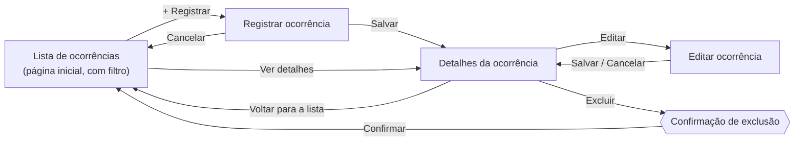

# 4. Interface (IHC)

## Mapa navegacional

## Telas

| Tela | Conteúdo |
|---|---|
| Lista | Filtro recolhível (busca por palavra, tipo, de, até), contagem de resultados e cartões clicáveis com tipo (uma cor por tipo), marca "Novo", data, local e resumo da descrição. |
| Registrar / Editar | Formulário com tipo, data e hora (já preenchida com o momento atual), local, descrição (com contador de caracteres) e nome opcional. Todos os erros aparecem juntos no topo. O botão Salvar trava depois do primeiro clique. |
| Detalhes | Todos os dados da ocorrência, "Editado em" quando houver edição, e os botões Compartilhar no WhatsApp, Editar e Excluir. |
| Erro | Página amigável para endereço inexistente (404), ação não permitida (405), formulário expirado (400) ou falha interna (500). |

## Mensagens do sistema

| Situação | Mensagem |
|---|---|
| Cadastro concluído | "Ocorrência registrada com sucesso." (fica na tela até ser fechada) |
| Edição concluída | "Ocorrência atualizada com sucesso." |
| Exclusão | Confirmação: "Tem certeza que deseja excluir esta ocorrência? Esta ação não pode ser desfeita." Depois: "Ocorrência excluída." |
| Dados inválidos | Lista dos erros, por exemplo "Informe o local da ocorrência." |
| Data digitada errada | "Data inválida. Escolha a data e a hora pelo calendário." |
| Data muito antiga | "A data da ocorrência deve estar dentro dos últimos 12 meses." |
| Endereço de ação aberto direto | "Este endereço não pode ser aberto diretamente. Use os botões do sistema." |
| Formulário expirado ou vindo de outro site | "A página ficou aberta por muito tempo ou veio de outro site. Volte, recarregue a página e tente de novo." |
| Filtro com período invertido | "A data inicial é maior que a data final, por isso nenhuma ocorrência aparece." |
| Lista vazia | "Nenhuma ocorrência encontrada." |

## Princípios de usabilidade aplicados

Seguindo o material teórico da disciplina:
- **Clareza e simplicidade:** poucas telas, linguagem do dia a dia e exemplos dentro dos campos.
- **Consistência:** o mesmo formulário serve para registrar e editar.
- **Resposta ao usuário:** toda ação mostra uma mensagem de resultado.
- **Prevenção de erros e reversibilidade:** validação dos campos e confirmação antes de excluir.
- **Uso no celular:** layout responsivo, filtro recolhido para a lista aparecer primeiro, cartão inteiro clicável e letras maiores nos rótulos e nas datas.
- **Reconhecimento rápido:** cada tipo de ocorrência tem uma cor.
