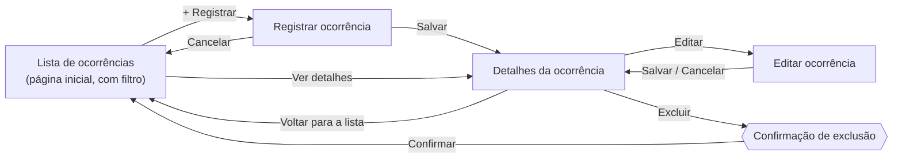

# 4. Interface (IHC)

## Mapa navegacional

## Telas

| Tela | Conteúdo |
|---|---|
| Lista | Filtro (tipo, de, até), contagem de resultados e cartões com tipo, data, local e resumo da descrição. |
| Registrar / Editar | Formulário com tipo, data e hora, local, descrição (com contador de caracteres) e nome opcional. Erros aparecem no topo. |
| Detalhes | Todos os dados da ocorrência e os botões Editar e Excluir. |
| Erro | Página amigável para endereço inexistente (404) ou falha interna (500). |

## Mensagens do sistema

| Situação | Mensagem |
|---|---|
| Cadastro concluído | "Ocorrência registrada com sucesso." |
| Edição concluída | "Ocorrência atualizada com sucesso." |
| Exclusão | Confirmação: "Tem certeza que deseja excluir esta ocorrência? Esta ação não pode ser desfeita." Depois: "Ocorrência excluída." |
| Dados inválidos | Lista dos erros, por exemplo "Informe o local da ocorrência." |
| Filtro com período invertido | "A data inicial é maior que a data final, por isso nenhuma ocorrência aparece." |
| Lista vazia | "Nenhuma ocorrência encontrada." |

## Princípios de usabilidade aplicados

Seguindo o material teórico da disciplina:
- **Clareza e simplicidade:** poucas telas, linguagem do dia a dia e exemplos dentro dos campos.
- **Consistência:** o mesmo formulário serve para registrar e editar.
- **Resposta ao usuário:** toda ação mostra uma mensagem de resultado.
- **Prevenção de erros e reversibilidade:** validação dos campos e confirmação antes de excluir.
- **Uso no celular:** layout responsivo, pensado para quem acessa pelo telefone.
