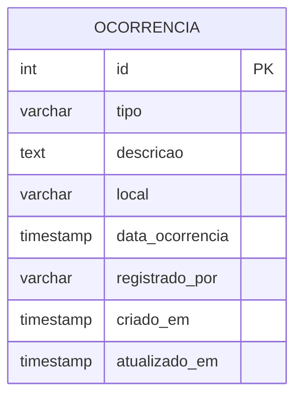

# 5. Banco de dados

SGBD: **PostgreSQL** (hospedado no Neon). Nos testes automatizados é usado SQLite em memória.

## Modelo conceitual

Uma única entidade, **Ocorrência**, que representa um fato de segurança registrado por um morador. Nesta versão não há cadastro de usuários; o nome de quem registra é um atributo opcional da própria ocorrência.

## Modelo lógico

`OCORRENCIA (id, tipo, descricao, local, data_ocorrencia, registrado_por, criado_em, atualizado_em)`
- Chave primária: `id`.
- A tabela está na 3ª forma normal: todos os atributos dependem apenas da chave e não há grupos repetidos.
- O tipo é validado pela aplicação (lista fixa de valores, regra RN01).

## Modelo físico

O script está em [`schema.sql`](schema.sql). A tabela é criada automaticamente pela aplicação na primeira execução (`db.create_all()`). Bancos criados pela primeira versão recebem a coluna `atualizado_em` automaticamente ao iniciar a aplicação.

## Dicionário de dados

| Coluna | Tipo | Nulo? | Descrição | Regra |
|---|---|---|---|---|
| id | SERIAL | Não | Identificador da ocorrência | Chave primária, gerada pelo banco |
| tipo | VARCHAR(30) | Não | Tipo da ocorrência | Furto, Tentativa de furto, Movimentação suspeita, Vandalismo ou Outro |
| descricao | TEXT | Não | O que aconteceu | Entre 10 e 1000 caracteres |
| local | VARCHAR(120) | Não | Onde aconteceu | Obrigatório |
| data_ocorrencia | TIMESTAMP | Não | Data e hora do fato | Não pode estar no futuro nem ser anterior a 12 meses |
| registrado_por | VARCHAR(80) | Não | Nome de quem registrou | "Anônimo" se não for informado |
| criado_em | TIMESTAMP | Não | Momento do registro no sistema | Preenchido automaticamente; define a ordem da lista |
| atualizado_em | TIMESTAMP | Sim | Momento da última edição | Preenchido ao editar; vazio se nunca foi editada |
