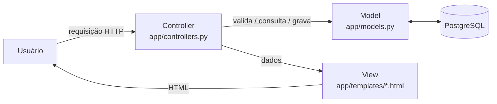

# Arquitetura da solução

## Tecnologias

| Camada | Tecnologia |
|---|---|
| Linguagem do back-end | Python 3.12 com Flask |
| Acesso a dados | SQLAlchemy (ORM) |
| Segurança dos formulários | Flask-WTF (proteção CSRF) |
| Banco de dados | PostgreSQL (Neon) |
| Front-end | HTML (templates Jinja), CSS e JavaScript puro |
| Testes | pytest |
| Hospedagem | Render (aplicação) e Neon (banco) |
| Modo de codificação | Tradicional |

## Padrão MVC

| Camada | Arquivo | Responsabilidade |
|---|---|---|
| Model | `app/models.py` | Entidade `Ocorrencia`, regras de validação e mapeamento para a tabela |
| View | `app/templates/*.html`, `app/static/` | Telas em HTML, estilo (CSS) e comportamentos simples (JS) |
| Controller | `app/controllers.py` | Rotas: listar, registrar, detalhar, editar e excluir |
| Configuração | `app/__init__.py`, `wsgi.py` | Cria a aplicação, conecta o banco, liga a proteção CSRF e trata os erros 404, 405, 400 (CSRF) e 500 |

## Rotas

| Método | Endereço | Ação |
|---|---|---|
| GET | `/` | Lista, filtra e busca as ocorrências (`?q=`, `?tipo=`, `?de=`, `?ate=`) |
| GET, POST | `/ocorrencias/nova` | Formulário e cadastro |
| GET | `/ocorrencias/<id>` | Detalhes |
| GET, POST | `/ocorrencias/<id>/editar` | Formulário e edição |
| POST | `/ocorrencias/<id>/excluir` | Exclusão |

## Tratamento de erros

- Dados inválidos: o formulário volta com a lista de erros e com o que já tinha sido digitado (HTTP 400).
- Ocorrência inexistente: página "Página não encontrada" (HTTP 404).
- Endereço de ação aberto pela barra de endereço: página "Ação não permitida" (HTTP 405).
- Formulário sem token CSRF válido: página "Formulário expirado" (HTTP 400).
- Falha inesperada: a transação do banco é desfeita e aparece a página "Erro interno" (HTTP 500).

## Testes automatizados

36 testes em `tests/`:
- `test_modelo.py` (13): testes unitários das regras de validação (RN01 a RN05).
- `test_rotas.py` (21): testes de integração que simulam o uso das telas (cadastro, lista, ordem, busca, filtros, edição, exclusão, compartilhamento e erros).
- `test_csrf.py` (2): testes de integração com a proteção CSRF ligada, como em produção.
